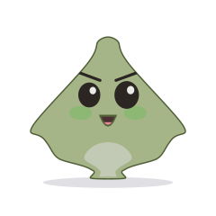
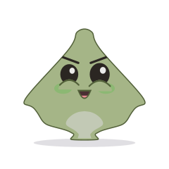
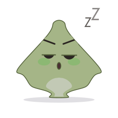
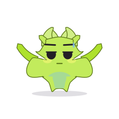
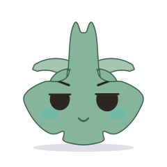
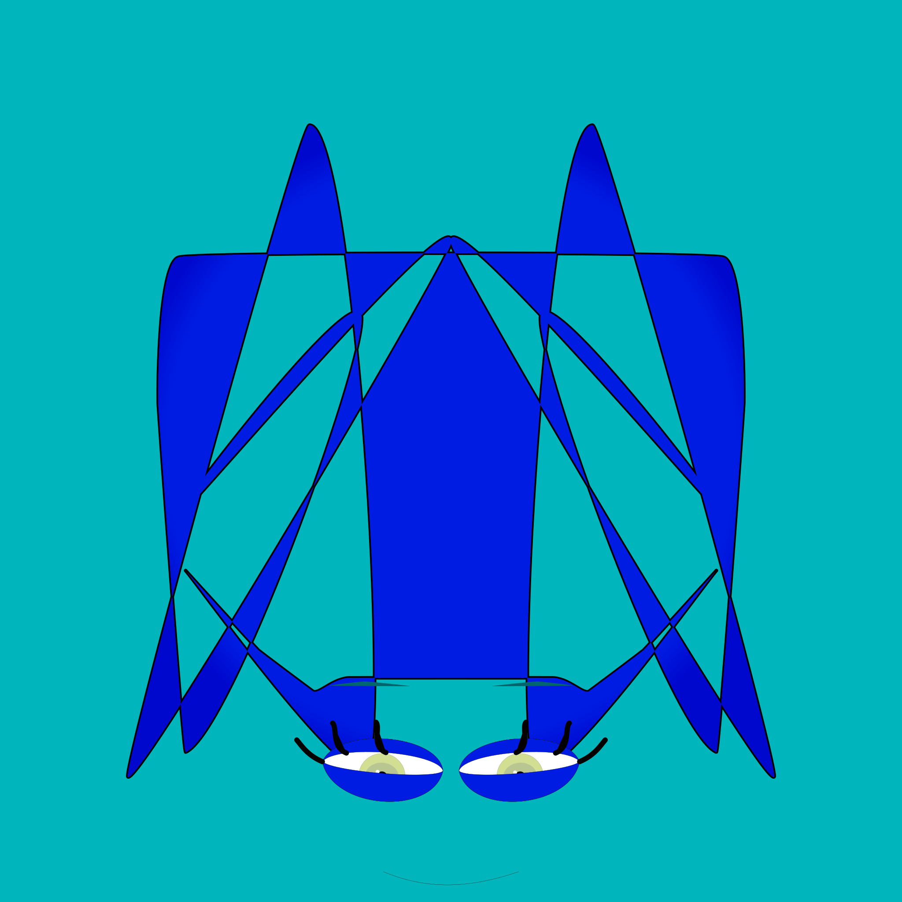

# avatar

> [!WARNING]
> **Alpha.** Avatar is in early development and is not yet released for general use.
> Breaking changes will happen between versions, including changes to its settings,
> stored data and interfaces. Pin an exact version if you depend on it.

Deterministic creatures for software agents.

<p>






</p>

Every agent gets a creature of its own. The creature is drawn from a
**genome**, a fixed-length run of bytes that is generated once and then
stored with the agent, together with the creature's **type** (which
generator draws it) and **version** (which generation of that generator).
At draw time a **mood** is added: neutral, working, happy, waiting,
blocked, sad or sleepy. A mood moves the face; it never changes who the
creature is.

The same genome, type, version and mood always produce the same bytes, on
every platform. A creature drawn by a Rust server, an iPhone app and a web
page is the same creature, down to the last coordinate. The images above
are files from the golden corpus in `vectors/`, which every language is
tested against.

Avatar is a library. It has no service and no store, and it never decides
which genome an agent has: the application that keeps track of agents
generates and stores the genome, and every surface that shows the agent
draws from that stored record. Every byte pattern of the right length is
a valid creature.

The project descends from TOG ("Same Same but Different: Tokens of
Gratitude"), the author's earlier procedural SVG creature project, built
to run entirely on chain. The `creature.classic` type is derived from it:
its body and face geometry and its palette table come from TOG, its seven
moods extend TOG's five, and its genome layout keeps TOG's
one-byte-per-parameter style. It
was re-specified in fixed-point arithmetic, so that it is identical on
every platform, rather than ported float for float. `creature.wild` is a
new design built on the same machinery, with a genome sixteen times
larger. Six more types draw that same wild genome in other styles:
`creature.wild-plus`, `creature.sprouts`, `creature.pixel-critters`,
`creature.knitted-toys`, `creature.small-robots` and
`creature.drawn-heads`.

## How it fits together

```text
stored record             generator, chosen by       render tree               output
genome bytes, type,  -->  type and version      -->  flat list of drawing  --> SVG, canonical JSON,
version, + a mood         (written once, in Rust)    primitives                or native drawing
```

Every generator is written once, in Rust. Other languages never
reimplement a generator: they receive the **render tree** it produces and
draw it. That is a correctness decision rather than a cost one. Testing
two independent implementations against a corpus only shows that they
agree on the sampled genomes, out of an input space of 2^131072 for a
wild genome, and a divergence that fires for one genome in a billion
stays invisible until it reaches someone's screen. One generator makes
that divergence impossible instead of merely unlikely to be caught.
`docs/design/011-port-surface.md` has the argument and the measurements.

## Crates and ports

The library crates are published under `cortexkit-` package names.
Each keeps a short library name, which is what code imports.

| Package | Import as | What it is for |
| --- | --- | --- |
| `cortexkit-avatar` | `avatar` | Renders a stored avatar: dispatch by type and version, finished images (`render_image`), plus the tree types and serializers re-exported. The one crate a Rust host depends on. |
| `cortexkit-avatar-svg` | `avatar_svg` | The classic and wild generators, the render tree, the canonical tree JSON and the SVG serializers. |
| `cortexkit-avatar-<stem>`, one for each of `wild-plus`, `sprouts`, `pixel-critters`, `knitted-toys`, `small-robots` and `drawn-heads` | `avatar_<stem>`, with `_` for `-` | The generator of the type `creature.<stem>`: `render_tree` draws a genome in a mood, `decode` reads its traits. |
| `cortexkit-avatar-raster` | `avatar_raster` | Rasterizes a render tree, or a tree's SVG, to RGBA pixels; `avatar::render_image` draws through it. |
| `cortexkit-avatar-genome` | `avatar_genome` | The classic 1 KiB genome and its decoder, the palette table, and genomes derived from an identifier at any length. |
| `cortexkit-avatar-phenotype` | `avatar_phenotype` | The typed fixed-point units and the `Phenotype` struct a classic genome decodes to, with its canonical JSON. |
| `cortexkit-avatar-tables` | `avatar_tables` | Committed sine and easing tables and the one rounding division, which keep classic arithmetic identical everywhere. |

Not published:

| Where | What it is |
| --- | --- |
| `crates/avatar-ffi` | The C boundary (`avatar_render_tree_json`, `avatar_render_image`) built into the Swift package's embedded core. See `crates/avatar-ffi/README.md`. |
| `crates/avatar-export` | A command-line tool: renders a stored genome to PNG, SVG or tree JSON, and mints genome manifests. |
| `crates/avatar-vectors` | The golden-corpus tests and the mint that writes `vectors/`. |
| `ports/swift`, `Package.swift` | AvatarKit, the Swift package: calls the embedded Rust core, decodes the tree, caches trees, composes transforms. |
| `ports/ts` | A strict TypeScript decoder for the tree JSON and an SVG serializer for the tree. No generator. |
| `playground/` | A review harness (its own Cargo workspace): review sheets, a placement-invariant checker, and a browser lab that mirrors the wild generator for design review. |

## The render tree

A render tree (`crates/avatar-svg/src/tree.rs`) is a flat list of
primitives in painter order: shapes and paths, paints (solid colours and
gradients), strokes, transforms, and effects such as masks. Every value
is already resolved, so drawing a tree is a straight loop with no
decisions left in it.

- **Coordinates are integers, 100 times finer than the SVG canvas.**
  `canvas` is the edge of the SVG viewBox; normalise coordinates by the
  tree's extent (`RenderTree::extent()` in Rust, `tree.extent` in Swift),
  never by `canvas`. Dividing by `canvas` draws a creature 100 times too
  large, which looks like a plausible zoom rather than a bug. Classic draws
  on a 10,000-unit canvas; wild, wild-plus, sprouts, small robots and
  drawn heads on 240; knitted toys on 200; pixel critters on 24, one unit
  per cell of its pixel grid.
- **Key behaviour on `role`, never on `label`.** A label is a diagnostic
  name with no stability promise. A role is the contract. The one role so
  far is `ground_shadow`. Every wild creature has exactly one; wild-plus,
  sprouts, knitted toys and small robots mark their ground shadow with it;
  classic, pixel critters and drawn heads draw none. A view with no ground
  plane hides it.
- **Three projections.** `serialize_tree_json` writes the canonical JSON
  every other language decodes. It writes each distinct mask once, in a
  top-level `masks` table that masked effects refer to by index, and the
  decoders resolve those references back into the same in-memory tree.
  `serialize_tree` writes SVG for any tree
  (`serialize_tree_with_id_prefix` when several creatures share one
  document). `serialize_svg` is classic's historical SVG layout, kept
  because its corpus pins it.
- **Decoders fail closed.** The Swift and TypeScript decoders refuse an
  unknown tag, role or field, a missing field, a fraction where an integer
  belongs, and a broken mask reference. A silently defaulted primitive
  would draw a wrong creature that looks right.
- **Do not normalise visual weight.** No consumer may crop a creature to
  its ink, nudge its scale or enforce a minimum size: how much ink a
  creature has is part of who it is.

`docs/design/006-render-tree.md` specifies the tree and its JSON.

## Using it

### From Rust

```toml
[dependencies]
cortexkit-avatar = "0.1"
# or, before a crates.io release, straight from this repository:
# cortexkit-avatar = { git = "https://github.com/cortexkit/avatar", rev = "<commit>" }
```

The package is `cortexkit-avatar`; the library it provides is `avatar`.
It is the only avatar crate a Rust host needs to render: it re-exports
the tree types, `Mood` and the serializers.

```rust
use avatar::{render_tree_for_bytes, serialize_tree, serialize_tree_json, DispatchError, Mood};

/// `genome`, `avatar_type` and `version` are what is stored with the agent,
/// for example 16,384 bytes, `avatar::WILD` and 2. Never substitute the
/// library's newest version for the stored one.
fn draw(genome: &[u8], avatar_type: &str, version: u32, mood: Mood)
    -> Result<(Vec<u8>, String), DispatchError>
{
    let tree = render_tree_for_bytes(genome, avatar_type, version, mood)?;
    // SVG bytes, and the canonical JSON for a client that draws the tree itself.
    Ok((serialize_tree(&tree), serialize_tree_json(&tree)))
}
```

`render_tree_for_bytes` checks the type, then the version, then the
genome length that type needs, and the order is part of the contract. An
unknown type or version (`DispatchError::UnsupportedType`,
`UnsupportedVersion`) means "this build cannot draw it": draw nothing and
stay quiet, because a client older than the record it reads is normal.
A wrong length for a known type (`GenomeLength`) means the record is
malformed: report it. Nothing falls back to a default creature, since a
confidently wrong face is worse than an empty slot.

To give a new agent its first genome, either store random bytes of the
type's length (1,024 for classic; 16,384 for wild and the six types that
read its genome) or derive them from a stable identifier with
`avatar_genome::derive_genome_bytes`
(`cortexkit-avatar-genome`). Then store the result, and draw from what is
stored: the genome may later be re-rolled, so never cache a creature by
agent id alone. Cache by genome, type, version and mood.

### From the command line

`avatar-export` renders a stored genome to a file. Try it on a genome from
the corpus:

```sh
cargo run -p avatar-export -- --genome-file vectors/wild/wild-port-0005.hex \
    --type creature.wild --version 2 --mood happy --out creature.svg
```

The `--out` extension picks the format: `.png` or no extension for PNG
(`--size N` pixels, default 400), `.svg`, or `.json` for the canonical tree.
`--genome <hex>` takes the hex inline, and `--genome-file -` reads it from
standard input. `--mint-genomes <id,id,...|@file> --type <type>` writes a
JSON manifest of genomes derived from identifiers, one record per agent
with its type and version.

### From Swift

AvatarKit is a Swift package consumed by git URL. It supports iOS 13 and
macOS 11 and later.

```swift
.package(url: "https://github.com/cortexkit/avatar.git", exact: "<release>")
```

```swift
import AvatarKit

let tree = try renderTreeViaCore(genomeBytes: record.genome, type: record.type,
                                 version: record.version, mood: .happy)
for primitive in tree.primitives {
    // build a Path from primitive.shape, scaled by tree.extent
}
```

The package carries the Rust generator as an **embedded core**:
`ports/swift/AvatarCore.xcframework`, committed static libraries for arm64
iOS, the arm64 iOS simulator and arm64 macOS, so an app needs no Rust
toolchain and nothing to embed or sign. `renderTreeViaCore` calls it
through the C boundary and decodes the result. Rendering is pure and safe
from any thread, and the tree types are `Sendable`. `RenderTreeCache` is
a cache the app owns, keyed by genome, type, version and mood, and it can
be emptied under memory pressure. Each core failure maps to its own
`CoreRenderError` case: `unsupportedType` and `unsupportedVersion` mean
draw nothing, `genomeLength` means report the record.

The six types that read the wild genome (wild-plus, sprouts, pixel
critters, knitted toys, small robots and drawn heads) come to an app as
finished images: `renderImageViaCore(genomeBytes:type:version:mood:sizePx:options:)`
returns an `AvatarImage` of RGBA pixels drawn by the same core. Their
trees use tree features only Rust draws, which the Swift and TypeScript
decoders refuse.

Two things worth knowing before writing the drawing loop:

- **The manifest is at the repository root, the sources are not.** SwiftPM
  only consumes a git dependency whose manifest sits at the root of the
  clone, so `Package.swift` is there while the sources stay in
  `ports/swift/` beside the other ports. There is no top-level `Sources/`.
- **Scale by `tree.extent` and key on `primitive.role`**, as described
  under The render tree.

On Linux the package builds without the embedded core and can decode
trees, but cannot generate them.

### From TypeScript

The TypeScript port is not published as a package; use the sources in
`ports/ts/src`. It draws trees that Rust generated, for example the
`.json` output of `avatar-export` or a host's `serialize_tree_json`.

```ts
import { decodeRenderTreeJson } from "./ports/ts/src/tree.ts";
import { serializeTree } from "./ports/ts/src/tree-serialize.ts";

const tree = decodeRenderTreeJson(jsonBytes); // throws on anything it does not recognise
const svg = serializeTree(tree); // the same bytes as Rust's serialize_tree
```

## Types and versions

| Type | Genome | Versions | Notes |
| --- | --- | --- | --- |
| `creature.classic` | 1,024 bytes | 2 | The TOG-derived creature. Integer and fixed-point arithmetic throughout. |
| `creature.wild` | 16,384 bytes | 1, 2 | The current design. Version 2 fixes mood lids and squints that version 1 draws beside eyes the creature's eye aspect has narrowed; version 1 still draws every record that stores it. |
| `creature.wild-plus` | 16,384 bytes | 1 | The wild body as the head, with more masses, limbs, a crest, a tail, a coat and a hide pattern (`crates/avatar-wild-plus`). |
| `creature.sprouts` | 16,384 bytes | 1 | Small plant creatures: a plant-organ body with a face, shoots grown from rules the genome writes, and roots (`crates/avatar-sprouts`). |
| `creature.pixel-critters` | 16,384 bytes | 1 | Pixel-art creatures on a 24 by 24 grid (`crates/avatar-pixel-critters`). |
| `creature.knitted-toys` | 16,384 bytes | 1 | Crocheted plush toys; less stitch detail at small sizes (`crates/avatar-knitted-toys`). |
| `creature.small-robots` | 16,384 bytes | 1 | Little machines with a hull, running gear, arms and tools; less detail at small sizes (`crates/avatar-small-robots`). |
| `creature.drawn-heads` | 16,384 bytes | 1 | Flat, front-facing heads drawn in ink; less detail at small sizes (`crates/avatar-drawn-heads`). |

The six newer types read the same stored genome as `creature.wild` and
base their body colour on wild's, so only the type field selects the look.
They are delivered as finished images (`avatar::render_image`, the C
boundary's `avatar_render_image`, AvatarKit's `renderImageViaCore`), drawn
at the size the image is shown at.

The dispatch arms in `crates/avatar/src/dispatch.rs` are the
authority. A record renders at the version it stores, never at the
library's newest, so an agent's face changes only when someone decides it
should:

- **Fixing a generation bug adds a version.** The old arm stays byte for
  byte, keeps its corpus vectors, and records move to the new version only
  when someone chooses to.
- **A different depiction is a new type**, not a version. Types are
  different representations of the same genome behind one interface, and
  a new genome layout is always a new type.
- **An arm is added, never edited.** Once records use a type, changing
  what one of its versions draws would silently change their faces.

`docs/design/012-version-and-type-procedure.md` has the procedure for
each. The corpus manifest's `corpus_revision` is not a creature version:
it counts re-mints of the corpus and says nothing about what any creature
looks like.

## The determinism guarantee

The same genome, type, version and mood produce the same bytes on every
platform. That holds because no generation path is allowed to depend on
the platform:

- **No platform maths library.** Trigonometry, exponentials, logarithms,
  powers, `hypot`, `cbrt` and `mul_add` differ between platforms in the
  last digits. `crates/clippy.toml` refuses every one of them in every
  crate, under `-D warnings`.
- **`creature.classic` is integer-only**: milliunit coordinates, Q32.32
  factors, 16-bit binary angles, sine and easing from committed lookup
  tables, and one rounding rule (half away from zero).
- **`creature.wild` uses `f64`, limited to the operations IEEE 754 makes
  exact everywhere**: `+ - * /`, `sqrt`, comparisons and rounding. Its
  sine, cosine, tangent and arctangent are built from those
  (`crates/avatar-svg/src/wild/math.rs`). The limit matters because a wild
  creature branches on computed values: in measurement, a difference in
  the fourteenth digit flipped a branch and moved part of a creature by 93
  of its 240 canvas units. The six newer types follow the same rules.
- **Serialization is hand-written and canonical**, for both the SVG and
  the tree JSON.

How it is checked:

- **The golden corpus** in `vectors/`, written only by its mint, pins four
  boundaries: genome to classic phenotype (`dna/`, `phenotype/`), classic
  phenotype to SVG (`svg/`), tree to canonical JSON (`tree/`) and tree to
  SVG (`tree-svg/`), plus the wild reference genomes in `vectors/wild/`.
  Rust renders every vector and compares bytes. Swift decodes every tree
  and re-encodes it to identical bytes, and its embedded-core tests
  reproduce every tree through the shipped binary. TypeScript decodes
  every tree and serializes each one to its `tree-svg/` file.
- **Coverage of the genome space**: the `fleet_coverage` example decodes
  1,000 synthetic classic genomes and fails if a decode branch they reach
  has no corpus vector.
- **Across platforms**: `scripts/wild-cross-platform.sh` mints the wild
  corpus natively on macOS arm64 and in Linux arm64 and x86_64 containers
  and compares the bytes (it needs Docker, so it runs by hand). The CI
  workflow runs the Rust tests, corpus included, on Linux and Windows.
- **The committed tables** are regenerated and compared by their mint
  (`cargo run -p cortexkit-avatar-tables --bin mint -- --check`).
- **The embedded core** is checked against a hash of every source it is
  built from (`ports/swift/AvatarCore.source-hash`), so a binary that is
  stale against its Rust source fails the gate even though every test,
  which builds from source, would pass.

## Building and running the checks

You need a recent stable Rust toolchain. The TypeScript port needs
[Bun](https://bun.sh); the Swift suite needs Swift 5.9 or later (Xcode on
macOS).

```sh
cargo test --workspace                       # Rust, golden corpus included
(cd ports/ts && bun install --frozen-lockfile && bun test && bunx tsc --noEmit)
swift test                                   # from the repository root
```

`scripts/check.sh` is the repository's gate and runs everything:
formatting, clippy on both profiles, every test, the corpus coverage
check, the table mint check, the playground's own checks and placement
invariants, the embedded core's freshness, a scan for absolute
home-directory paths in tracked files, a comparison of the browser lab
against the Rust generator, and the TypeScript and Swift suites. By
default it expects the maintainers' build-server client, `ck` (not
published), and sends the cargo stages to a Linux build server; to run
every stage on your own machine instead:

```sh
AVATAR_GATE_LOCAL=1 scripts/check.sh               # everything
AVATAR_GATE_LOCAL=1 scripts/check.sh --rust-only   # skip the TypeScript and Swift suites
```

The browser lab comparison needs `chrome-headless-shell` (or `CHROME_BIN`
pointing at a Chrome binary), and the Swift stage runs only where `swift`
is installed. The gate never rewrites tracked files, and fails if a build
does.

To re-mint golden vectors after an intended change, which needs a reason
the diff can show:

```sh
UPDATE_GOLDEN=1 cargo test -p avatar-vectors tests::mint -- --exact --nocapture --ignored       # classic
UPDATE_WILD_GOLDEN=1 cargo test -p avatar-vectors tests::mint -- --exact --nocapture --ignored  # wild
```

Then paste the printed pins back into `crates/avatar-vectors` and open
`vectors/contact-sheet.html` to look at every changed cell.

The embedded core is rebuilt on macOS with Xcode, after
`rustup target add aarch64-apple-ios aarch64-apple-ios-sim aarch64-apple-darwin`,
by `scripts/build-xcframework.sh`; rebuild it whenever the Rust it embeds
changes. Rebuilds of the same source are byte-identical.

## Documents

- `ARCHITECTURE.md`: how the pieces fit, error handling, and the gate.
- `STRUCTURE.md`: the directory map, and where new code goes.
- `docs/design/001` to `006`: `creature.classic`, from the determinism
  contract and genome layout through the phenotype schema, geometry, face
  and mood, to the render tree.
- `docs/design/009`: the wild genome's region layout. Wild version 1's
  exact byte map lives in its decoder, `crates/avatar-svg/src/wild/`,
  inside that note's region boundaries.
- `docs/design/011`: why every type has one generator, and how wild stays
  deterministic in floating point.
- `docs/design/012`: how a creature is allowed to change: versions,
  types, and the procedure for each.

## Contributing

**Open an issue before writing code, and wait for a go-ahead.** Label it
`design discussion` or `bug`. A pull request without one will be asked
for the issue before it is reviewed: a conversation that fits in ten lines
of an issue costs hundreds of lines and several review rounds once an
implementation exists. Bug fixes with an obvious shape move fast: issue,
reproduction, fix.

This repository has a particular reason to hold that line: every visual
change is somebody's agent's face. Read `docs/design/012` before
proposing one.

## License

MIT. See `LICENSE`.
